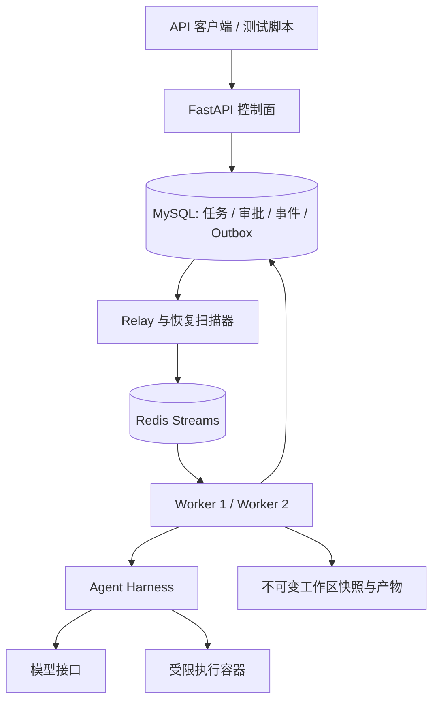

# Spec2Repo 改造计划

本文面向项目开发者，确定约 1.5 周内可交付的后端优先版本，以及实现时必须保持的可靠性边界。目标是通过亲自运行、测试和复盘，理解规格驱动代码生成、异步调度、失败恢复和执行追溯，不要求现场演示或公开部署。

**状态：第六阶段已接入并通过真实成果验收。** 平台独立 HTTP 验收、最多两轮修复、持久报告与鉴权下载形成闭环。第五阶段 deepseek-flash 生成的笔记 API 快照通过 15 项正式检查，进入 SUCCEEDED；本轮无新增模型调用。两个业务套件覆盖笔记 v1 与任务 v2，任务套件用手写夹具验证，修复链路用脚本模型与真实容器验证，不合并成模型成功率。详见 [第六阶段学习记录](docs/PHASE_06_WALKTHROUGH.md) 和 [运行说明](docs/RUN_VERIFICATION.md)。第五阶段调用与开发测试记录继续保留。后续进入第七阶段联调与评估；本文完整指标仍是目标，不把计划当作已有能力。

投入预算：约 50 小时，其中开发联调 35 小时、测试和故障实验 10 小时、阅读复盘与讲解 5 小时。模型费用目标上限人民币 200 元；第五阶段真实实验经用户授权调用已有模型服务，以调用和 token 额度限制规模。没有可靠计费配置时费用保持未知，不能把额度预留量当账单金额。

学习节奏：说明一个问题 → 实现可运行切片 → 执行测试 → 阅读一条调用链 → 用户复述关键机制。每阶段结束后讨论理解，再推进依赖它的下一阶段。

每阶段交付时同步维护 [学习与面试题单](docs/INTERVIEW_QUESTION_BANK.md)：参考相关公开面经，按主题追加当前实现对应的问题、追问和代码/实验证据，并更新旧题的能力边界。题号保持稳定，不把未实现能力或未经用户复述的知识标为已掌握。

## 1. 产品定位与首版交付

首版定位为“规格驱动的代码交付 Agent 后端”：接收结构化规格，生成 Python API 服务，在隔离环境中执行验收，通过后交付仓库与执行报告。OpenAPI 导入和自由文本抽取延后。

主展示场景选择任务管理 API，覆盖创建、查询、分页、状态更新、参数校验和不存在资源的错误处理。生成目标栈固定为 FastAPI + Pydantic + SQLite；平台本身使用 MySQL + Redis。两个数据库承担不同职责，避免同时调试平台分布式能力与生成应用的复杂部署。

需要亲自验证的运行链路：

```text
提交规格 → 规格校验 → 生成计划 → 人工批准 → 异步代码生成
         → 隔离验证 → 有界修复 → 验收结果与仓库下载
                         ↑
                 worker 中断后恢复
```

首版支持多个 run 分配给不同 worker；同一个 run 同时只允许一个有效执行者。文件 DAG 可用于依赖排序，首版不做单个 run 内的分布式并行文件生成。

### 1.1 必须交付的能力（P0）

以下能力共同组成最小完整版本，必须能通过实际运行和测试验证。

| 能力 | 交付内容 | 完成依据 |
|---|---|---|
| 规格契约 | CoreSpec、需求 ID、验收条件、规格版本 | 一个任务可追溯到需求和验收项 |
| Agent 执行 | 工具循环、上下文组装、预算、验证与修复 | 真实模型完成至少一个代表性场景 |
| 异步任务 | FastAPI、MySQL 状态、Redis Streams、两个 worker | API 重启后可查询任务，多 worker 可消费 |
| 可靠投递 | 事务 outbox、幂等提交、重复消息处理 | 注入双写失败和重复投递后状态正确 |
| 故障恢复 | 租约、执行代次、阶段检查点、工作区快照 | 杀死 worker 后从已提交阶段继续 |
| 隔离执行 | 受限容器、最小环境变量、资源与网络限制 | 生成代码无法通过挂载或环境直接读取平台凭证 |
| 审批与取消 | 持久化审批、版本绑定、协作式取消 | 重启后审批有效，取消会终止所属执行容器 |
| 可观测性 | 持久事件、工具记录、模型用量、结果报告 | 能解释一次失败发生在哪一步 |
| 基础访问控制 | 预配置 API key、owner 校验 | 两个测试身份不能读取或取消对方任务 |
| 回归评估 | 固定规格集、独立验收、故障注入 | 提交可复现报告，不混淆流程结束与验收通过 |

### 1.2 有余量再实现的能力（P1）

P1 不得挤占恢复测试、验收质量、代码阅读和真实模型联调时间。自定义前端、SSE 和视频制作不属于本轮。

- OpenTelemetry 导出；P0 先统一 run_id、attempt_id、step_id、tool_call_id。
- 更多真实模型重复实验、上下文压缩策略和细分成本图表。

### 1.3 后续版本能力

首版不承担任意语言、任意 PRD、任意前后端框架的生成承诺。Paper Profile 及其适配器、前端、SSE、跨主机工作区存储、复杂 RBAC、计费、GitHub 自动提 PR、MCP 插件市场、多 agent 协作、Kubernetes 和多区域高可用放到后续版本。

业务泛化使用同栈案例检查。第六阶段先落实笔记管理与任务管理的独立套件；预约管理留作联调扩展，真实模型多案例重复评测另行记录。两个套件仍属于同一个 Python API Profile，不等同于多领域适配成功。

保留 Profile 接口并不等于完成泛化验证。只有第二种 Profile 通过完整生成与验收链路后，才能对外声称已验证多领域复用。

## 2. 现有项目的复用与迁移

现有 Paper2Repo 提供工具循环、证据追溯、验证修复和本地恢复基础；新目录采用独立包，逐项提取可复用能力，保留旧项目作为回归参照。

| 现有实现 | 迁移决策 |
|---|---|
| graphs/execute/agent.py | 提取循环控制、工具调用和终止机制；清除论文与单文件硬绑定 |
| graphs/execute/tools.py | 复用参数模型、路径校验、审计思想；子进程执行替换为 SandboxRunner |
| execution_context.py | 复用按任务组织上下文的机制；来源改为需求、接口、当前代码和验证失败 |
| schemas.py | 提取通用模型；保留 ML 字段在旧项目或后续 MlProfile 中 |
| graphs/execute/nodes.py | 按能力迁移需要的函数，禁止整体复制约 7,247 行的模块 |
| runtime/checkpoint.py | 保留在旧项目；新版本另建任务阶段 checkpoint，避免直接共享本地 SQLite |
| storage/mysql.py | 复用连接管理和参数化 SQL 的经验；新建平台控制面表及迁移脚本 |
| web/app.py | 复用交互需求；用持久任务服务替换内存 JobStore 和 daemon thread |
| tests、benchmarks | 复用测试方法；历史论文结果不能作为新版本成功率 |

实施前记录旧项目的基线 commit 或工作区说明，并识别已有未提交修改。不要覆盖用户现有变更，不同步维护两份相同业务代码。

## 3. 架构与技术取舍

首版采用模块化单体加独立 worker 进程，重点实现可靠任务语义，降低服务拆分成本。



| 组件 | 首版选择 | 边界 |
|---|---|---|
| API | FastAPI + Pydantic | 请求鉴权、参数校验、任务查询；不在请求中运行 agent |
| 控制面数据库 | MySQL + SQLAlchemy + Alembic | 任务与审批的事实来源；不可用时停止提交状态 |
| 消息队列 | Redis Streams | 传递可重复的任务通知；不保存唯一业务真相 |
| Worker | 独立 Python 进程 | 首版每个 worker 同时处理一个 run |
| 流程编排 | 轻量阶段状态机；可复用 LangGraph 组织 agent 内部流程 | 恢复入口以 MySQL 阶段记录为准 |
| 执行环境 | Docker 受限容器 | 首版部署在 Linux 或 WSL2 的开发环境 |
| 产物 | 同一宿主上的共享命名卷或受控目录 | 支持多进程接管，不宣称跨主机恢复 |
| 事件展示 | MySQL 事件游标查询 | SSE 是可选传输层，不影响任务恢复 |

本轮不实现自定义 LangGraph MySQL checkpointer。预算优先投入阶段级恢复、工作区一致性和可靠消费；不承诺每次模型调用或工具动作都可以精确续跑。

Redis 的首版主要职责是 Streams 任务队列，可追加简单的 API 限流。执行所有权由 MySQL 控制，不再叠加另一套 Redis 锁作为权威。

## 4. 规格与 Agent Harness

CoreSpec 只表达需求与验收契约。首版 Profile 固定为 python_api，先支持 JSON 结构化规格。平台提供固定 Python 与预装依赖环境，但工作区从空目录开始，不预写 FastAPI 骨架，不按案例选择业务模板。

### 4.1 CoreSpec 的最小内容

规格必须能说明生成目标，并为验收提供稳定标识。

| 对象 | 必要内容 |
|---|---|
| Spec | id、version、profile、title、source_hash |
| Requirement | id、description、priority、source_refs |
| Interface | HTTP method、path、请求与响应 schema、错误响应 |
| AcceptanceCriterion | id、requirement_ids、输入条件、可检查的期望 |
| Constraint | 技术栈、运行环境、依赖许可范围、资源预算 |
| OpenQuestion | 缺失信息、冲突、待确认假设 |

关键业务行为缺失或冲突时进入 WAITING_CLARIFICATION，持久化问题并释放 worker；回答后形成新规格版本，再进入计划和审批。目录、模块划分等实现决策由 agent 自主决定。结构校验只能发现字段和引用错误，语义完整性仍需规划检查与独立验收。

### 4.2 执行阶段

按功能切片生成代码，避免为每个文件建立独立且互相矛盾的实现假设。

1. Normalize：校验输入并形成 CoreSpec。
2. Plan：生成 ImplementationPlan，关联需求、文件、接口和验收项。
3. Approve：持久化审批请求，释放 worker；批准后重新入队。
4. Implement：在当前 attempt 的工作区内执行有界工具循环。
5. Verify：运行独立验收，生成结构化失败摘要。
6. Repair：将失败反馈给 agent，最多两轮；每轮重新验证。
7. Finalize：提交产物、指标和最终验收状态。

初始工具集提供读取文件、列出文件、搜索代码、写文件或应用 patch、沙箱内通用终端和验证摘要。agent 自主选择操作顺序；权限通过挂载、网络、资源和宿主接口隔离约束，不依赖命令字符串黑名单充当沙箱。

实现计划可以修订，记录版本与简短理由，不因目录调整反复审批。涉及需求、公开 API、验收条件变更时必须暂停，形成新的规格决定和审批记录；初始批准不能授权后续降低验收标准。

每次模型调用前检查步数、剩余时间和 token 预算；请求超时受剩余时间约束。费用只有在存在可靠 usage 和价格配置时报告数值，缺失时标记 unknown，不用 0 代替。

### 4.3 完成与验证条件

agent 发出完成信号后仍需通过正式验证，不能仅凭模型自述进入 SUCCEEDED。

- 开发测试允许 agent 修改；正式验收程序由平台在独立验证容器中执行。
- 验收套件和规格版本绑定，agent 无写权限，发布报告记录其 hash。
- 正式验收包括接口契约和人工预先定义的业务用例；仅靠 LLM 生成测试不作为正确性的唯一证明。
- 正式验收反馈提供需求 ID、预期行为和实际行为，供 agent 修复；最终另用冻结输入变体回归，具体样例不加入修复上下文。所有行为必须可从规格推导。
- 验收器本身有误时，记录修订原因、升级版本并重跑受影响实验，不直接删除失败项改变结果。
- 每次提交关联 requirement_id、task_id、artifact_hash 和 verification_id。
- 首版采用上下文按需加载、工具输出截断、失败摘要；复杂长期记忆和自动压缩放到 P1。

## 5. 后端数据与 API 边界

数据模型围绕任务生命周期设计，避免为技术展示加入与业务无关的表。

| 表 | 职责与关键约束 |
|---|---|
| runs | owner_id、spec_version、status、generation、lease_owner、lease_until、cancel_requested、version |
| run_attempts | 每次接管的 attempt_id、generation、worker、起止时间、错误和工作区引用 |
| run_steps | stage、input_hash、status、checkpoint_ref；记录最后已提交的安全恢复点 |
| approvals | run_id、spec_version、plan_hash、决定和操作人；同一审批只接受一次有效决定 |
| outbox | event_id、run_id、调度代次、payload、发布时间和重试时间 |
| run_events | 单调事件游标、run_id、attempt_id、事件类型和脱敏 payload |
| artifacts | 内容 hash、路径、类型、大小、产生阶段和验收结果引用 |
| idempotency_keys | owner_id、key、request_hash、run_id；owner_id + key 唯一 |

模型和工具调用的明细可先作为 run_events 类型保存，大体积输出存产物。索引至少覆盖 owner + 创建时间、状态 + lease_until、未发布 outbox、run + 事件游标；通过查询计划核对常用查询。

拟定 API 表达操作语义，最终字段以实施时的 schema 为准：

| API | 语义 |
|---|---|
| POST /api/runs | 携带 Idempotency-Key 创建任务，返回 202 和 run_id |
| GET /api/runs | 按当前身份分页列出任务 |
| GET /api/runs/{id} | 返回运行状态、阶段、验收状态和预算 |
| POST /api/runs/{id}/approval | 对指定 spec_version 和 plan_hash 批准或拒绝 |
| POST /api/runs/{id}/cancel | 持久化取消请求；重复请求无额外效果 |
| POST /api/runs/{id}/retry | 对允许重试的失败任务创建新执行代次，保留旧记录 |
| GET /api/runs/{id}/events | 按 after 游标查询事件，用于轮询或后续 SSE |
| GET /api/runs/{id}/artifacts | 返回当前身份可访问的已提交产物 |

相同幂等键和相同请求返回原任务；相同键但不同请求返回 409，并提示使用新键。越权查询不暴露对方任务详情。首版采用预配置身份与 API key，不实现注册、密码找回和复杂角色体系。

## 6. 调度、恢复与一致性

首版按至少一次投递设计，允许消息与未提交工作重复执行，同时禁止过期执行覆盖当前结果。

### 6.1 可靠入队与消费

数据库是恢复依据，消息只是可重复的调度通知。

第三阶段模拟模式使用原 event_id 重发无模拟回执的通知。第四阶段执行模式忽略模拟回执：version 表示任务状态版本，generation 表示执行代次；恢复时事务创建新 Outbox，成功领取时递增 generation。具体迁移规则见第四阶段运行说明。

1. API 在同一 MySQL 事务内写入 run、幂等键和 outbox。
2. relay 领取未发布 outbox，向 Redis Stream 写入 event_id、run_id 和调度代次。
3. 发布成功后标记 outbox；发布后标记前崩溃可能产生重复消息，由消费者处理。
4. worker 在短事务中校验任务状态和代次，领取租约并创建 attempt；不在长事务里调用模型。
5. 重复或过时消息先核对数据库；已经完成或已有有效执行者时，不创建第二个有效执行。
6. 正常执行期间保留消息 pending；完成、进入持久等待或持久化重试安排后再 ACK。

首版可以使用 XAUTOCLAIM 扫描 pending，但消息 idle 不等于 worker 已死亡。接管必须额外检查 MySQL 租约；对仍有效的执行不得启动竞争 worker。

恢复扫描器同时检查数据库中长期未领取和租约过期的任务，为需要恢复的任务创建新的调度 outbox。因此即使 Redis 消息丢失，也有数据库对账恢复路径。Redis 开启持久化，Stream 保留策略不得随意裁掉正在执行的 pending 消息。

### 6.2 租约与过期执行隔离

第四阶段默认心跳周期为 10 秒、租约为 60 秒，恢复扫描每轮后等待 1 秒；扫描和容器清理时间另计。租约判断使用数据库时间，heartbeat 与阻塞执行分开运行。

每次领取递增 generation，作为 fencing token。提交阶段、变更状态、登记产物时，数据库同时校验当前 generation、lease_owner、有效租约和取消状态；校验失败的 worker 停止工作，不能更新权威结果。

每个 attempt 使用独立工作区和容器。共享位置只保存不可变快照，由数据库指向当前有效版本，防止旧 worker 即使继续运行也覆盖新工作区。此设计保证有效结果提交边界，不保证接管瞬间绝无重复计算。

### 6.3 检查点与文件一致性

检查点记录“哪个阶段已完成、输入是什么、对应哪份工作区”，不保存一个孤立的状态字符串。

阶段提交顺序为：完成工作 → 生成不可变工作区快照并校验 hash → 在 MySQL 事务中提交 step、artifact 引用和事件。快照已写入但数据库未提交时，视为孤立产物，后续清理；数据库不得引用未完成的快照。

恢复时创建新 attempt，从最后已提交快照重建工作区，跳过已完成阶段。中断发生在 Implement 内部时，可以重新执行该阶段；首版不保证从任意 token 或工具调用处恢复。

同一宿主共享卷是首版前提。宿主磁盘丢失、整机故障和跨主机接管不在本轮恢复承诺内；后续用对象存储和集中 checkpoint 扩展。

### 6.4 状态与失败分类

状态迁移由任务服务显式校验，并用版本或条件更新防止并发覆盖。

```text
QUEUED → RUNNING → WAITING_APPROVAL → QUEUED
            ├──→ WAITING_CLARIFICATION → QUEUED
            ├──→ RETRY_WAIT → QUEUED
            ├──→ SUCCEEDED
            ├──→ FAILED
            └──→ CANCELLING → CANCELLED
```

排队或审批中的任务可直接取消；运行中先记录取消请求，worker 停止新工具调用并终止所属容器。审批拒绝结束为 CANCELLED 并记录原因；RETRY_WAIT 到期、审批通过均通过 outbox 重新调度。

取消与完成竞争时，以数据库原子条件更新为准：成功先提交则取消返回任务已结束；取消先被接受则后续成功提交必须失败。不能仅在 Python 中读取状态后无条件写回。

区分基础设施暂态错误、规格错误、验证失败、权限拒绝和预算耗尽。暂态错误最多两次自动重试并指数退避；验证失败进入最多两轮修复；其他错误直接失败或等待明确决策。

上述次数约束针对任务执行层。投递服务连接 MySQL/Redis 失败时持续退避等待恢复，不因两次连接失败丢弃持久 outbox；第三阶段已实现这一投递策略。

重试耗尽后，数据库保留失败原因与原消息标识，并通过 outbox 投递到失败 Stream 供检查；人工重试创建新代次，不把旧失败记录抹掉。模型超时可能已经产生供应商费用，不宣称外部调用 exactly-once。

## 7. 执行环境与部署约束

容器执行是新项目的重要边界，但首版仍是受控环境中的参考实现，需要准确说明限制。

- 运行容器采用非 root、移除额外 capabilities、限制 CPU/内存/PID、超时清理。
- 只挂载当前 attempt 工作区；不挂载项目根目录、平台 .env、宿主凭证或 Docker socket。
- 镜像预装固定版本依赖，默认禁止外网访问；运行中缺少依赖时报告环境不满足，不允许任意联网安装。镜像修改作为单独维护操作。
- 模型请求由 worker 发出，生成代码容器不继承平台密钥和全部环境变量。
- 开发容器与正式验证容器分离，验收代码不进入可写生成目录。
- 只有可信 SandboxRunner 可调用宿主容器管理接口；其权限较高，不向 agent 暴露原始 Docker API。
- Compose 启动 MySQL、Redis、API、relay/recovery 和两个 worker；不宣称 MySQL/Redis 本身已实现高可用。

第一天必须验证 Docker/WSL2 环境。若环境不可用，可继续开发状态机与假执行器，但不得把本机 subprocess 降级方案当作已完成的沙箱交付。

## 8. 拟定代码组织

以下目录是完整实施目标。第六阶段的验收器放在 harness，验收报告放在 storage，套件与实验分别落在受保护代码和 docs/experiments；不为单一 Profile 额外搭建空抽象层。

```text
spec2repo/
  IMPLEMENTATION_PLAN.md
  pyproject.toml
  compose.yaml
  migrations/
  src/spec2repo/
    api/                 # 路由、鉴权、请求模型
    domain/              # CoreSpec、计划、状态及错误模型
    profiles/            # python_api；后续 ml_paper
    harness/             # agent loop、context、tools、budget、verification
    runtime/             # worker、lease、checkpoint、recovery、cancel
    storage/             # MySQL repositories、outbox、artifact store
    sandbox/             # 容器生命周期与执行策略
    observability/       # 事件、脱敏、usage
  tests/
    unit/
    integration/
    fault_injection/
  evals/                 # 固定规格、验收套件、评估报告
  scripts/               # 评估、故障注入入口
```

## 9. 50 小时的实施与学习安排

排期先用确定性假执行器验证后端，再接入真实模型。以下阶段分配到约 1.5 周，每个阶段结束后先复盘再推进。各列合计分别为开发 35 小时、测试 10 小时、阅读讲解 5 小时。

| 阶段 | 开发 / 测试 / 讲解 | 工作与退出条件 |
|---|---|---|
| 1. 规格与状态基础 | 3h / 1h / 0.5h | 建包、CoreSpec、生命周期、CLI；能拒绝无验收需求和非法状态迁移，检查容器环境 |
| 2. 持久任务 API | 5h / 1h / 0.5h | MySQL 迁移、幂等提交、鉴权；API 重启不丢任务，同键不重复建任务 |
| 3. 可靠投递 | 5h / 1.5h / 0.75h | Outbox、Streams、两个假 worker、对账；重复和漏投实验通过 |
| 4. 恢复与隔离 | 7h / 2h / 1h | 租约、generation、工作区快照、受限执行、取消；kill 与过期提交测试通过 |
| 5. Agent 与审批 | 7h / 1h / 0.75h | 空仓库工具循环、可修订计划、澄清与审批；模型开始实际生成 |
| 6. 验收与修复 | 5h / 2h / 0.75h | 独立验收、修复预算、两个业务案例；至少一个真实案例完整通过 |
| 7. 联调与复盘 | 3h / 1.5h / 0.75h | 完整回归、真实实验报告、调用链与失败窗口讲解；未完成项如实记录 |

关键依赖：阶段 3 依赖阶段 2 的事务与状态模型；阶段 4 同时处理数据库和文件快照；阶段 6 的成功口径依赖阶段 1 的验收契约。Docker 不可用时先完成独立逻辑，但隔离验收与故障实验仍不得标记完成。

阶段 4 超时时缩减可选遥测和生成任务规模，保留恢复测试。阶段 6 仍未通过真实案例时，减少业务复杂度和评测次数，停止新增功能，保留真实失败记录；不能以假执行器结果替代真实 agent 验证。

## 10. 验收与实验计划

验收分为确定性后端测试与真实模型评测，两者分别报告，避免把 mock 测试成功率当作 agent 成功率。

### 10.1 后端与故障验收

下面的条件是测试目标，实际结果写入后续报告。

| 场景 | 验收要求 |
|---|---|
| 幂等提交 | 同身份同键同请求重复 10 次，只有一个 run；不同请求返回冲突 |
| 重复投递 | 同一事件投递 10 次，不出现多个有效结果提交 |
| 数据库提交后 relay 故障 | 恢复 relay 后任务最终入队，原 run_id 不变 |
| worker 被杀 | 租约到期后接管，已提交阶段不重跑，未提交阶段允许重跑 |
| 旧 worker 恢复 | 所有过期 generation 的状态与产物提交均被拒绝 |
| Redis 短暂不可用 | 新任务保持可查询；恢复后通过 outbox/对账继续处理 |
| 审批等待时服务重启 | 审批、计划版本仍在；重复审批不重复调度 |
| 运行中取消 | 不再开始新工具调用，执行容器在配置宽限期内被终止 |
| 验证失败 | 返回失败检查与需求映射，不能标为 SUCCEEDED |
| 身份隔离 | 身份 A 不能读取、下载、审批、取消身份 B 的任务 |
| 并发消费 | 2 个 worker 处理 20 个假任务，任务均有终态，无重复有效提交 |

报告接管耗时、排队耗时、完成数、失败数与重复提交数，并说明测量起点。初步恢复目标为检测到租约过期后 30 秒内开始新 attempt；该目标不包含已提交快照恢复时间和任务完成时间，也不等于进程退出后 30 秒恢复。

### 10.2 Agent 效果评估

准备任务管理、预约管理两个同栈规格，覆盖基础 CRUD、分页过滤、非法输入、状态迁移与资源冲突。冻结验收套件，另留至少 2 个输入变体用于最终回归，避免针对固定反馈写特判。

- 对照 A：相同模型的单次生成。
- 对照 B：完整 harness，包含按任务上下文、执行验证和最多两轮修复。
- 固定模型标识、输入、依赖镜像、验收器版本及总预算上限。
- 每例至少运行一次；预算允许时运行三次。样本少时报告逐例结果，不宣称统计显著。
- 报告首次验收通过率、最终通过率、修复轮数、耗时、token、费用与失败类别。
- 缺失 usage 标记 unknown；超时和评测基础设施故障单列，不默认为通过。

交付门槛是至少一个真实代表性场景完整通过，以及所有样例结果可复查；不在实施前预填成功率。若只有假执行器跑通，应明确标注 agent 真实效果尚未验证。

## 11. 学习交付与范围降级

最终材料帮助开发者从实际运行解释到代码、测试和设计取舍，不要求面试现场演示。

必须交付：可启动代码、数据库迁移、运行说明、固定规格与验收套件、故障注入入口、真实评估报告和阶段学习记录。学习记录覆盖问题、失败过程、解决方式和剩余边界，能够画出完整时序，指出相邻步骤间崩溃的后果。

简历只能填写已实现和实测内容。单宿主两个 worker 可以描述为多 worker 异步执行与故障接管，不写成经过生产验证的高可用平台；阶段恢复不写成任意工具调用精确恢复。

UI、SSE、Paper Profile 和自然语言抽取已经移出首版。时间不足时再缩减外部遥测集成、业务规模和实验次数，保留结构化规格、独立验收、MySQL 状态、可靠入队、接管隔离、受限执行和故障测试。

## 12. 调研依据

2026-10-25 增补：已接入工具轨迹关联、精确重复停滞干预、连续验收失败提示，以及 baseline/memory/guarded 三组对照入口。设计和实验执行边界见 [Agent 评估](docs/AGENT_EVALUATION.md)。真实模型效果结论必须以另行执行的对照报告为准，不能用脚本测试通过率代替。

以下来源来自前一轮调研，支持设计取舍，不代表本项目已经实现对应能力。网页可能持续更新，具体依赖版本在实施时锁定。

| 来源 | 与本计划的关系 |
|---|---|
| [Anthropic：长任务 Harness](https://www.anthropic.com/engineering/harness-design-long-running-apps) | 验收反馈与长任务执行 |
| [LangChain：Harness Engineering](https://www.langchain.com/blog/improving-deep-agents-with-harness-engineering) | 自验证、上下文、循环检测和实验 |
| [GitHub Spec Kit](https://github.com/github/spec-kit) | 规格驱动流程 |
| [Kiro Specs](https://kiro.dev/docs/specs/) | 需求、设计、任务及验收关联 |
| [Temporal Durable AI](https://docs.temporal.io/ai) | 持久执行与等待恢复 |
| [Microsoft Durable Extension](https://learn.microsoft.com/en-us/agent-framework/hosting/durable-extension) | 图 checkpoint 与分布式执行的边界 |
| [Redis XAUTOCLAIM](https://redis.io/docs/latest/commands/xautoclaim/) | Pending 消息接管 |
| [RabbitMQ Reliability](https://www.rabbitmq.com/docs/reliability) | 消息可靠性的备选方案 |
| [MySQL Locking Reads](https://dev.mysql.com/doc/refman/8.4/en/innodb-locking-reads.html) | 并发领取和短事务锁 |
| [AWS Transactional Outbox](https://docs.aws.amazon.com/prescriptive-guidance/latest/cloud-design-patterns/transactional-outbox.html) | 双写问题与幂等消费 |
| [OpenTelemetry GenAI](https://opentelemetry.io/blog/2026/genai-observability/) | 调用链与模型用量观测 |
| [E2B Sandbox Persistence](https://docs.e2b.dev/sandbox/persistence) | 工作区状态与执行状态的区分 |
| [gVisor Security Model](https://gvisor.dev/docs/architecture_guide/security/) | 执行隔离的安全边界 |
| [MCP Security Best Practices](https://modelcontextprotocol.io/docs/2026-07-28/tutorials/security/security_best_practices) | 后续工具集成的权限边界 |
| [SWE-bench](https://www.swebench.com/) | 可验证编码任务的评估参照 |
| [Terminal-Bench 2.0](https://www.tbench.ai/news/announcement-2-0) | 隔离评测环境与验证器质量 |
| [Promptfoo Coding Agent Red Team](https://www.promptfoo.dev/docs/red-team/coding-agents/) | 注入、越权与验证器保护 |
| [Langfuse Compare Experiments](https://langfuse.com/docs/evaluation/experiments/compare-experiments) | 固定评测口径与对照实验 |
