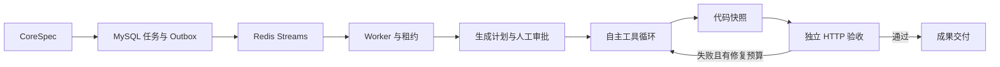

# Spec2Repo

规格驱动、支持自主编码与独立验收修复的 Coding Agent。以结构化 CoreSpec 为输入，结合持久任务服务、受限执行、任务记忆和独立验收，完成从规格到可运行仓库的生成与修复。

## 工作流程

## 核心设计

- **规划与执行**：Plan-and-Execute + ReAct，模型自主选择文件和终端工具；依赖感知的工具并行，审批与澄清控制业务边界。
- **记忆与上下文**：结构化任务笔记、工具证据分页、完整消息组裁剪；记忆绑定提交快照，保持恢复后的代码与任务记录一致。
- **可靠后端**：FastAPI、MySQL、Redis Streams；事务 Outbox、请求幂等、租约心跳、执行代次隔离和阶段恢复。
- **受限执行与验收**：固定 Docker 镜像、网络及资源限制；平台拥有独立验收器，失败后最多两轮修复。
- **轨迹与评估**：关联模型调用、工具证据和验收结果，检测精确重复失败，支持 baseline/memory/guarded 对照实验。

## 开始运行

宿主需要 Python 3.11+、uv 与 Docker。运行目录为仓库根目录，各角色使用同一数据库和工作区。

1. 阅读 [Agent 运行指南](docs/RUN_AGENT.md)，安装锁定依赖、生成专用测试配置、构建运行镜像并执行测试。
2. 参考 [.env.example](.env.example) 设置数据库、API 身份和模型服务变量；真实 `.env` 不应提交，也不能挂载到沙箱。
3. 阅读 [独立验收与成果下载](docs/RUN_VERIFICATION.md)，启动 API、Relay、Recovery 和 Agent Worker，并提交 [笔记 API 示例](examples/notes_api.spec.json)。

数据库迁移使用 `alembic upgrade head`。测试会清理专用测试库，勿与真实模型实验同时运行。真实模型实验会调用配置的供应商并产生费用；普通脚本模型测试不需要模型密钥。

## 代码与设计导航

- `src/spec2repo/harness/`：模型循环、工具、上下文、停滞检测和验收。
- `src/spec2repo/storage/`：事务、租约、记忆、快照与持久状态。
- `src/spec2repo/runtime/`：消息投递、消费、恢复和 Worker。
- `tests/`：契约、数据库、消息及真实 Docker 测试。
- [记忆设计](docs/MEMORY_CONTEXT.md)、[工具并行](docs/PARALLEL_TOOLS.md)、[轨迹评估](docs/AGENT_EVALUATION.md)、[实现计划](IMPLEMENTATION_PLAN.md)。
