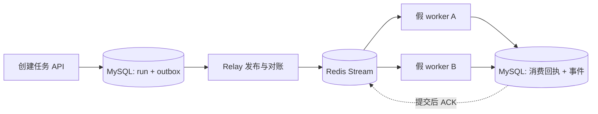

# 第三阶段：可靠投递与模拟消费

这一阶段把 MySQL 中的发送意图交给 Redis Streams，再由两个独立假 worker 消费。完成本节后，你应能解释每个提交与 ACK 间隙发生故障时，系统怎样重试、在哪里去重，以及为什么这还不等于 Agent 执行恢复。运行步骤见 [投递服务运行说明](RUN_DISPATCH.md)。

## 1. 当前交付和成功口径

本阶段的成功指“一个调度事件只有一条持久模拟消费回执”。假 worker 不生成代码、不调用模型、不改变任务状态，也不把任务标为 SUCCEEDED。队列正常处理后，任务仍是 QUEUED，事件列表新增 `dispatch.simulated`。



新增 `dispatch_receipts` 表，以 outbox 的 event_id 为主键，记录 consumer、outcome 和时间。`simulated` 表示模拟处理完成，`obsolete` 表示任务已取消、状态或版本不再符合通知。重复通知不再写回执或事件。

运行时实现集中在 [delivery.py](../src/spec2repo/runtime/delivery.py)、[streams.py](../src/spec2repo/runtime/streams.py) 和 [服务入口](../src/spec2repo/runtime/__main__.py)。建表由 [0003 迁移](../migrations/versions/0003_dispatch_receipts.py) 完成。

## 2. 为什么接受重复投递

MySQL 与 Redis 没有一个共同的本地事务。relay 先 XADD，再标记 published_at；若前者成功、后者失败，数据库会认为需要重发。先标记再 XADD 则可能留下永远没有发送的任务。

当前选择保留可重试性：允许同一 event_id 对应多个 Redis 消息 ID，用数据库中的 event_id 去重。不能以 Redis 消息 ID 作为业务去重键，因为每次 XADD 都会生成新 ID。这是 [Transactional Outbox](https://docs.aws.amazon.com/prescriptive-guidance/latest/cloud-design-patterns/transactional-outbox.html) 模式在本项目中的具体实现。

relay 每次 `SELECT … FOR UPDATE SKIP LOCKED` 选一条未发布记录，发出一次有超时的 Redis 请求，再更新发布时间。两个 relay 可以跳过对方已锁定的行。本阶段采用持锁发布的简单方案；数据库锁会覆盖这次网络调用，不能据此宣称高吞吐。

Redis 连接与命令超时各为 2 秒，客户端自动重试关闭，外层循环对 Redis/SQLAlchemy 异常退避重试，等待上限 5 秒。实际操作还包含连接和数据库时间，不承诺整个事务严格在 2 秒结束。更高吞吐的后续方案可以引入带过期时间的发布领取记录，把网络调用移出事务，但需要同时处理发布者死亡后的回收。

## 3. 为什么在数据库提交之后 ACK

消费者先校验通知中的 event_id、run_id 和 version 是否与 MySQL outbox 一致，再锁定 run 行完成模拟消费事务。回执与审计事件共同提交后才 ACK。锁 run 行也使模拟消费决定与取消操作串行化。

| 故障位置 | 数据库结果 | 后续处理 |
|---|---|---|
| XADD 前失败 | outbox 未标记 | relay 重试 |
| XADD 成功、标记失败 | 消息可能存在，outbox 仍未标记 | 重发，消费者去重 |
| 收到消息、消费事务提交前失败 | 没有回执 | 消息留在 pending，重新领取 |
| 回执提交、ACK 前失败 | 回执已经存在 | 重复处理只 ACK，不重复提交 |
| 已发布的 Stream 整体丢失 | outbox 和回执仍在 MySQL | 无回执的通知经对账补发 |

消费组用 `0-0` 创建，能读到建组之前发布的消息；新工作用 XREADGROUP 的 `>` 读取。ACK 清除的是消费组待确认状态，不删除 Stream 的消息实体。相关语义见 [XREADGROUP](https://redis.io/docs/latest/commands/xreadgroup/) 和 [XACK](https://redis.io/docs/latest/commands/xack/)。

## 4. Pending 接管和数据库对账解决不同问题

XAUTOCLAIM 处理“消息还在，但原消费者没有确认”。本实现保存扫描游标，每轮最多获取 10 条到达 idle 阈值的 pending 通知，并继续读取一条新消息，避免只扫描旧消息而饿死新工作。默认 idle 阈值 30 秒。空批次不代表扫描结束，要继续使用返回游标。[Redis 官方 XAUTOCLAIM 文档](https://redis.io/docs/latest/commands/xautoclaim/)说明了游标和 idle 机制。

数据库对账处理“通知或整个消费组已经丢失”。relay 每 10 秒扫描一次，将发布时间超过 60 秒且没有回执的 outbox 重新置为未发布；随后正常补发。每批最多 100 条，有回执的记录不重发。这个阈值只是减少不必要重复，不是任务完成时限或恢复 SLA。

当前重发沿用同一个 event_id，version 也是任务状态版本，**不是调度 generation**。第四阶段需要基于真实 attempt、租约和执行进度决定是否创建新代次。本阶段不把 Redis idle 解释为 worker 死亡，也不据此恢复长时间模型调用；假 worker 只有短数据库事务，没有跨事务的外部副作用。

## 5. 无效通知与故障定位

无法解析或与数据库不匹配的消息进入 `<stream>:rejected`，只保存消息 ID 和固定原因码，不复制原始输入。Lua 先写拒收记录，再 ACK；若写拒收记录失败，ACK 不执行，原通知仍留在 pending。它用于诊断投递格式问题，不是已经实现的任务业务失败重试系统。

Redis 服务异常会输出异常类型，避免直接打印连接 URL、SQL 或消息正文。暂态连接故障不会因为重试两次就丢弃 outbox；程序持续退避等待基础设施恢复。计划中的“任务最多两次自动重试”和“修复最多两轮”属于后续执行层，不能与投递重试混为一谈。

本地 Compose 将 Redis 绑定到回环地址，开发服务开启 AOF everysec、noeviction 并使用命名卷。测试服务使用 tmpfs；实验不证明持久卷断电恢复。没有实施 Stream 裁剪，ACK 后消息仍占空间；部署到长期环境前需补充安全的保留与清理策略。当前是单 Redis 实例，不支持 Redis Cluster 的跨槽脚本或高可用切换。

## 6. 实验结果

2026-10-19，在 Windows/Python 3.13、Docker Linux 的 MySQL 8.4 和 Redis 7.4 上，完整套件 **74 passed、2 skipped**。两个跳过项仍是 SQLite 下的 MySQL 专属并发测试，对应 MySQL 测试通过；TestClient 仍有一条依赖弃用提示。新增测试见 [test_delivery.py](../tests/test_delivery.py)。

| 实验 | 观测 |
|---|---|
| 同事件投递 10 次 | 一条模拟回执、一个模拟事件，pending 清零 |
| XADD 成功后注入 SQL 更新失败 | 重试后 Redis 有两条通知，数据库只有一条回执 |
| 消费事务写回执失败 | 事务回滚，消息保留 pending，新消费者可接管 |
| 消费提交后注入 ACK 超时 | 接管后识别 duplicate，回执不增加 |
| 删除本测试的整个 Stream | 从 MySQL 补投，重新建组后可消费 |
| 两个消费者并发处理同事件 | 一个 simulated、一个 duplicate |
| 两个 relay 并发发布 20 个事件 | 20 个不同事件均发布，无遗漏 |
| 两个独立 worker 进程处理 20 个任务 | 20 条回执、20 个模拟事件；两个身份均有处理记录 |
| 取消后的旧通知、错误 run_id、格式错误 | 旧通知记 obsolete，错误通知拒收，不产生生成结果 |
| 拒收 Stream 类型错误 | 拒收写入失败时原消息未 ACK |

另运行了 [真实 Redis 停机实验](../scripts/redis_outage_experiment.py)：实际停止专用 Redis 容器，在停机期间通过 FastAPI TestClient 创建和查询任务，确认发布失败后 outbox 仍未标记；恢复 Redis 后原 run_id 获得模拟回执。这里 HTTP 调用由进程内测试客户端执行，不冒称公网或独立 API 进程压测。

可复查输出：

```text
Redis stopped: HTTP create/query succeeded; publication remains pending.
Redis restored: original run_id consumed with one durable simulation receipt.
```

## 7. 下一阶段的接口边界

当前证据支持至少一次通知与事务内幂等模拟提交，不支持“模型调用恰好一次”“生成仓库已经恢复”或“两个真实 Agent 并发完成任务”。同一 run 的真实执行租约、generation、工作区快照、容器清理、任务级失败重试与预算仍在第四阶段及以后实现。

接入真实执行器时，需要替换 SimulationWorker 和模拟回执判定，设计旧模拟数据的处理方式。真实消费者必须使用独立消费组，并重新核对 MySQL 执行状态；不能把 `dispatch.simulated` 当作业务完成依据。

本阶段题单新增 Q035～Q044。建议先复述 Q035、Q037、Q038、Q039、Q042，再画出“消费已提交但 ACK 丢失”的时序。统一题目见 [学习与面试题单](INTERVIEW_QUESTION_BANK.md)。
