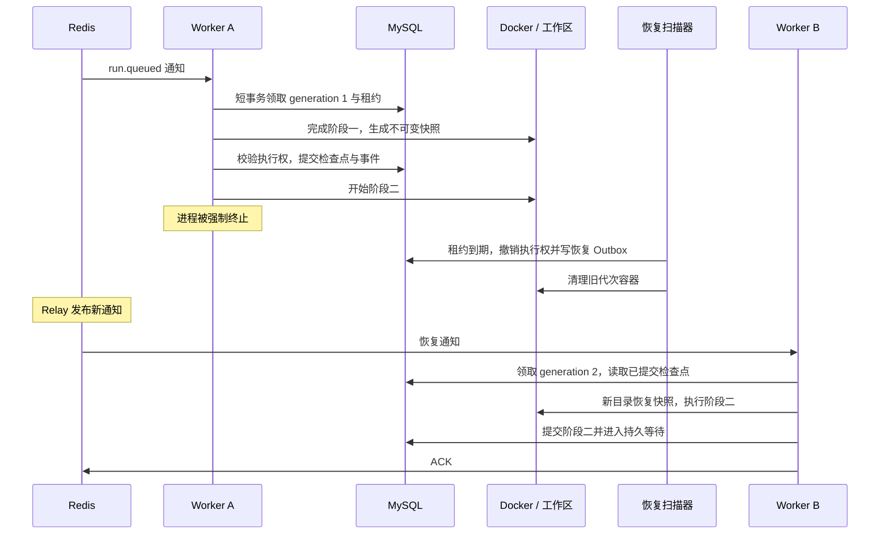

# 第四阶段：执行中断后，如何安全接着做

这一阶段把“可靠地送到 worker”向前推进为“worker 执行到一半退出后，其他 worker 能安全接管”。阅读后，你应当能解释租约、代次、工作区快照分别解决什么问题，并沿着真实的 kill 实验讲清恢复过程。

执行主体是两个固定文件操作阶段，用来稳定制造故障窗口；它运行在真实 Docker 容器中，不调用模型。阶段一保存 prepared.txt，阶段二检查该文件并保存 checked.txt。两个阶段提交后进入 WAITING_APPROVAL，释放租约，再 ACK。这个状态验证持久等待的交接；真实计划审批在第五阶段接入，代码生成验收在第六阶段接入。

## 1. 先把系统想成一个接力任务

假设两个人接力写作业：甲写完第一页，把副本放进保险柜，然后开始第二页。甲突然离开，乙应该拿出第一份已保存的副本，接着完成第二页。甲回来后不能把乙的结果覆盖掉。

对应到项目中：

| 作业例子 | 项目里的机制 | 解决的问题 |
|---|---|---|
| 限时有效的工作证 | MySQL 租约 | 判断谁现在有权执行 |
| 每次接班换一张新编号的工作证 | generation | 拒绝旧执行者迟到的提交 |
| 每个人有自己的草稿本 | 每代次独立工作区 | 旧执行者不能改新执行者的文件 |
| 保险柜里的已保存副本 | 内容 hash 标识的快照 | 接管时获得稳定、可校验的文件状态 |
| 进度登记本 | checkpoints 与 run_events | 只有事务提交过的阶段才算完成 |

代码入口是 [ExecutionWorker](../src/spec2repo/runtime/executor.py)，执行权规则集中在 [ExecutionRepository](../src/spec2repo/storage/execution.py)。通知仍沿用第三阶段的 Outbox 和 Redis Streams。

恢复事务先撤销旧执行权，再清理容器。新 worker 可能在旧容器清理完之前启动；不同工作区与数据库 fencing 允许这个短暂重叠，不能把它描述成“物理上绝无重复计算”。

## 2. 租约为什么要过期，也为什么要续期

只写“任务属于 worker A”会留下一个问题：A 死掉后，所有人仍认为任务归它。租约增加到期时间；A 必须周期性续租，证明它仍有执行能力。

默认租约 60 秒、心跳 10 秒。心跳运行在独立线程，容器里的命令长时间阻塞时，仍能续租。测试把租约缩短为 6 秒、心跳缩短为 1 秒，以较短时间复现恢复行为。心跳间隔必须小于租约的一半。

领取、续租和提交都使用 MySQL 的 UTC_TIMESTAMP(6)，避免依赖不同 worker 的本地时钟。提交时先锁定任务行，再读取数据库时间：如果先读时间再等待行锁，拿到锁时可能已经过期，却仍用旧时间错误放行。

心跳遇到数据库错误会设置停止信号；命令轮询看到信号后结束容器。最终结果提交仍必须经过数据库校验，所以停止信号晚到也不能授权过期结果。数据库连接与命令有超时，但取消耗时还受 Docker、数据库和调度影响，不能直接承诺固定的毫秒级响应。

## 3. version 与 generation 不要混用

version 表示任务状态变化了多少次，用于状态并发控制。generation 表示成功领取过多少轮执行权，用于隔离不同 attempt。它们都递增，但触发条件不同。

| 时刻 | status | version | generation |
|---|---|---|---|
| 新任务入队 | QUEUED | 0 | 0 |
| A 领取 | RUNNING | 1 | 1 |
| A 过期，扫描器重新排队 | QUEUED | 2 | 1 |
| B 领取 | RUNNING | 3 | 2 |
| B 完成 fixture 并等待 | WAITING_APPROVAL | 4 | 2 |

恢复通知携带排队时的 version=2、generation=1；B 成功领取时才把 generation 加到 2。这里的消息 generation 是领取前的基线，不是给 worker 预先授予的工作证。

状态、代次、持有者、有效租约、规格 hash 都匹配，才能续租、提交检查点、进入等待或登记失败。运行中的取消会改变状态，因此自动阻断这些提交。普通状态修改入口也不能绕过执行租约，把运行任务直接改成成功。

## 4. Redis 消息换了消费者，不等于执行权换了人

长任务执行时，消息一直 pending。XAUTOCLAIM 可以因为消息 idle 而把通知交给 B，但 A 可能仍在运行并正常续租。这时 B 查 MySQL，得到 busy，既不启动另一份有效执行，也不确认掉 A 正在处理的通知。

只有恢复扫描器发现租约过期，才在短事务中把旧 attempt 标为 LOST，释放租约、推进状态版本，并创建新的 Outbox。新 worker 再通过领取事务取得新 generation。行锁和 SKIP LOCKED 的具体语义见 [MySQL 官方说明](https://dev.mysql.com/doc/refman/8.4/en/innodb-locking-reads.html)；消息 idle 的含义见 [Redis XAUTOCLAIM](https://redis.io/docs/latest/commands/xautoclaim/)。

第三阶段的模拟回执不能证明真实执行完成。因此执行模式使用 execution-v1 消费组，对账依据 QUEUED 状态，不依据 dispatch_receipts。超过 60 秒仍未领取的任务会重新发布当前版本通知。即使 Redis 消失，MySQL 中的状态与 Outbox 仍提供恢复依据。

## 5. 数据库之外，还要保护文件

如果 A 与 B 共用一个可写目录，即使数据库拒绝 A 的提交，A 仍可能把 B 的源码改坏。所以工作区按任务 ID 和 generation 分开，容器只挂载自己这一代的目录。

[Workspaces](../src/spec2repo/storage/workspaces.py) 将阶段完成后的普通文件打包，计算 SHA-256，写入单独的 snapshots 目录。容器无法访问这个目录。恢复先核对 hash，再向新代次的空目录解包，不复用旧目录。

登记顺序固定为：

1. 容器命令结束并移除容器，停止修改这份工作区。
2. 写完临时快照，按内容 hash 发布完整文件，再校验内容。
3. MySQL 事务重新检查执行权，提交检查点和对应事件。

文件系统与 MySQL 没有跨系统事务。这个顺序选择了可处理的失败方向：快照已写好、数据库提交失败，只留下无引用文件；数据库不会先登记一份还没写完的快照。无引用快照目前保留在本地供排查，自动垃圾回收不在这一阶段。

快照限制为 1,000 个普通文件、文件内容总计 16 MiB；拒绝符号链接、目录联接、硬链接和危险路径，解包前检查全部条目，防止路径穿越。它保存文件内容，不保留进程内存、空目录或任意 Unix 文件权限。这是适合小型 Python API 的阶段恢复格式。

## 6. 取消是“先撤权，再清理，再确认”

API 把 RUNNING 改为 CANCELLING 后，所有后续检查点和完成提交都会失败。worker 的心跳与命令边界检查发现取消后，移除对应容器，再将任务改为 CANCELLED。

如果 worker 同时退出，独立 recovery 进程也会清理 CANCELLING 对应容器并完成取消。容器带任务和 generation 标签，清理前校验标签，避免误删不属于本次执行的容器。Docker 操作失败时不会谎报已经取消，后续扫描继续处理。

创建容器和启动容器分成两步，中间再次检查执行权。这缩小了“刚检查完有效，随后被恢复撤权，旧 worker 又创建容器”的窗口；即使执行重叠，旧代次仍无权提交，新目录和快照也不与它共享。

## 7. 沙箱约束限制的是权限与资源

[DockerSandbox](../src/spec2repo/sandbox/docker.py) 通过可信宿主程序调用 Docker。执行命令可以是参数数组，但不能由执行内容选择宿主挂载、网络或 Docker 管理参数。

| 约束 | 实际设置 |
|---|---|
| 身份与权限 | UID/GID 65534，移除全部 capabilities，no-new-privileges |
| 文件系统 | 根文件系统只读，只绑定本 attempt 工作区 |
| 网络 | network=none |
| 资源 | 1 CPU、256 MiB 内存、最多 64 个 PID |
| 临时与日志 | /tmp 64 MiB、noexec/nosuid；本地日志单文件最多 1 MiB |
| 凭证 | 不传入宿主完整环境变量，不挂载平台配置和 Docker socket |
| 生命周期 | 命令超时后移除容器；恢复扫描器清理遗留容器 |

这些设置来自 Docker 提供的运行约束，参见 [Docker 容器运行文档](https://docs.docker.com/engine/containers/run/)。基础镜像固定 digest，Python 依赖包含传递依赖的版本锁；worker 启动时把本地 tag 解析为 image ID，之后用该 ID 执行，不在任务运行中联网安装依赖。

这是一台宿主上的 Docker 隔离方案。Docker 管理程序属于可信平台；Linux 容器共享内核，不能把普通容器说成能抵御任意内核漏洞的强多租户隔离。快照大小限制发生在阶段提交时，也不是工作区磁盘的实时硬配额。

## 8. 实验证据与阅读顺序

2026-10-20 全量回归结果：**93 passed、2 skipped**，包含真实 MySQL、Redis 和 5 项 Docker 实验；Ruff 与依赖锁定检查通过。两个跳过项是原有 SQLite 不适用的并发用例，对应 MySQL 用例已经执行。保留一条 Starlette TestClient 的 httpx 弃用提示，不影响本轮通过。

本轮构建并实测的本地镜像 ID 为 `sha256:4258424cb9f118daaa16964e0d5bf0bf6c1ef7bfad32c744983b87840242b16d`。relay、执行 worker、recovery 的单轮 CLI 冒烟运行通过，结束时没有遗留带 spec2repo.run 标签的容器。镜像 ID 是这次构建记录，不承诺重新构建会因构建元数据相同而得到同一 ID。

真实测试入口见 [运行与故障复现](RUN_EXECUTION.md)。重点阅读 [执行测试](../tests/test_execution.py) 与 [快照测试](../tests/test_workspaces.py)：

- 并发领取只产生一个有效 owner；租约已过期的 worker 不能自行续活。
- 旧代次的心跳、检查点、等待和失败提交均被拒绝。
- 强制 kill 独立 worker 进程，等待数据库租约真实过期；接管后第一阶段仍属于 generation 1，第二阶段属于 generation 2。
- 修改旧工作区不改变恢复出的文件；篡改快照内容会触发 hash 校验失败。
- 6 秒租约下执行 10 秒阻塞命令，独立心跳保持所有权，竞争领取得到 busy。
- 运行中取消会移除容器，不提交第二阶段检查点。
- 容器内实际检查非 root、无额外权限、无平台凭证、网络关闭、根文件系统只读；并读取 Docker 配置核对资源限制。
- 超时会清理容器；路径穿越和快照超额被拒绝。
- 注入事件写入异常，检查点登记整体回滚；恢复事务也不会留下“旧 attempt 已失效，但没有恢复通知”的半完成状态。

真实容器实验最初发现日志驱动配置错误：local 驱动默认压缩与 max-file=1 组合导致启动失败。显式设置 compress=false 后，五项实验与全量回归通过。这个问题只有实际启动容器才会暴露，单独检查命令参数或模拟 Docker 调用不能替代集成测试。

恢复最多允许 3 个 generation，即初次执行加 2 次自动接管。耗尽后进入 FAILED，并保留 execution.exhausted 事件。本切片针对进程丢失做立即重新排队；更细的暂态错误分类、延迟重试及业务失败 Stream 仍按总计划后续接入，现有拒收 Stream 只负责无效通知。

使用同一宿主持久磁盘是恢复前提。宿主磁盘丢失和跨主机恢复需要共享存储或对象存储；当前没有进行此类验证。恢复清理按历史 attempt 检查容器，适合小规模实验，后续需要批处理与清理状态以控制扫描成本。

推荐阅读顺序：领取事务 → 心跳与 guard → 阶段快照提交 → recover → kill 测试。随后回答 [题单 Q045～Q054](INTERVIEW_QUESTION_BANK.md)，先讲故障场景，再讲机制，最后给出实验依据。
