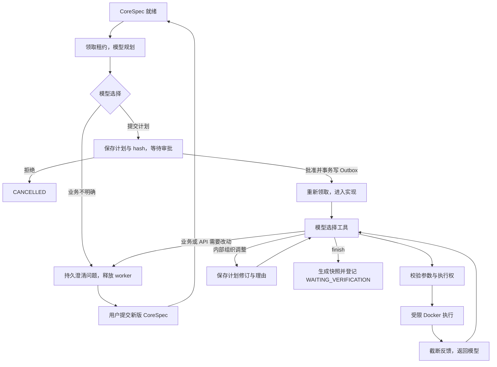

# 第五阶段：让模型在规则内自主写代码

后续进展：独立验收与正式修复已在 [第六阶段](PHASE_06_WALKTHROUGH.md) 接入。本文保留第五阶段实现与实验口径，WAITING_VERIFICATION 表示当时的提交结果，不代表整个项目的最终状态。

这一阶段把第四阶段的固定操作换成模型驱动的工具循环。阅读后，你应当能讲清：模型负责选择下一步，平台负责执行权限、审批、预算和结果登记；等待用户决定时，任务如何释放 worker，又如何可靠恢复。

代码已接入真实模型适配器，确定性测试使用脚本模型与真实 Docker。真实模型实验另行运行和记录，不能用脚本模型通过率代替生成质量。第六阶段负责独立验收与正式修复闭环，第五阶段的实现提交进入 WAITING_VERIFICATION。

## 1. 从“照步骤做”变成“看反馈决定下一步”

第四阶段的执行器只有两步固定操作，便于稳定制造进程故障。第五阶段的实现阶段没有固定文件生成顺序：模型可以先列文件、读取代码、写文件、运行命令，再根据结果修改实现。

完整链路为：

初始工作区为空，不预填业务实现模板。模型可以自主调整模块组织，但平台不提供直接改 CoreSpec、宣布 SUCCEEDED 或审批自己的工具。

## 2. Function calling 是一份请求，不是执行权限

模型返回工具名和 JSON 参数，宿主读取这份请求，按 Pydantic schema 校验，再决定是否执行。模型不会因为输出了 terminal 就直接获得宿主终端。

[工具定义](../src/spec2repo/harness/tools.py) 分阶段提供能力：

| 阶段 | 可用工具 |
|---|---|
| PLAN | propose_plan、request_clarification |
| IMPLEMENT | read_file、list_files、search_files、write_file、terminal、revise_plan、request_clarification、finish |

未批准前不提供写文件和终端工具；即使模型编造了工具名，宿主也会重新检查阶段能力集合。每轮最多接受一个调用，减少上下文关联和预算计数的复杂度。

文件工具也在容器里执行。宿主只把参数作为 JSON 数据传入，不把路径和文件内容插进宿主命令源码。终端接受参数数组，需要 shell 语法时可以在容器中使用 sh -c；第四阶段的挂载、权限、网络和资源约束仍然生效。

模型适配器采用 OpenAI-compatible Chat Completions 协议，沿用配置中的模型名。请求、工具执行、结果回传的协议流程参考 [OpenAI 官方 Function calling 文档](https://developers.openai.com/api/docs/guides/function-calling)。使用兼容协议不表示调用 OpenAI 服务；实际目的地由宿主配置决定。

## 3. 工具失败要让模型看见

开发测试出现 AssertionError，通常是模型应该利用的反馈。如果所有非零退出码都变成“平台任务失败”，模型就无法根据测试结果修改代码。

因此沙箱区分两类问题：

- **命令退出失败**：返回退出码和有长度限制的输出，模型可以修改文件后再次测试。
- **执行权丢失、容器管理失败、超时或快照错误**：交给运行时处理，不让模型通过重试绕过平台限制。

确定性集成测试让脚本模型先写入错误值，运行断言得到失败，再修改文件并运行成功。测试检查模型下一次收到的上下文中确实包含 AssertionError，而不只是检查最后文件碰巧正确。这项实验验证反馈链路，不能证明真实模型一定能修复相同错误。

## 4. 审批到底批准了什么

ImplementationPlan 包含实现任务、目标文件、需求 ID 和验收 ID。提交时检查所有需求与验收项均被覆盖，不允许引用不存在的项目。

审批绑定三个值：**规格 hash、计划 hash、计划修订号**。计划 hash 计算时包含规格 hash，因此同一段计划用于另一版规格，也不是同一个审批对象。

批准事务锁定任务，核对当前等待状态与版本，记录决定、切换实现阶段，并写入恢复 Outbox。重复提交同一有效决定返回已有结果，不产生第二条调度事件；相反决定、旧计划或旧规格会产生冲突。审批 API 从认证身份获得 owner，不信任请求里自报的身份。

计划保存与等待状态提交后，执行 attempt 结束，租约释放。几分钟后甚至服务重启后再批准，也不依赖某个 Python 协程还在内存里等待。

## 5. 内部改计划和改变业务要求不是同一件事

把一个文件拆成两个模块，可以通过 revise_plan 记录新版本和理由，不必反复打断用户。新计划仍绑定原规格，必须继续覆盖原有需求与验收项。

遇到业务歧义或想修改公开接口，模型应调用 request_clarification，平台持久化问题并释放 worker。用户提交完整的下一版 CoreSpec，并携带期望状态版本，避免在过时任务上回答。系统保存旧、新规格，清空待回答问题与旧实现快照，重新规划和审批；预算不随澄清重置。

结构校验能保证引用和覆盖，也能阻止通过工具直接修改 CoreSpec，但不能自动证明模型写的自然语言计划在语义上完全遵守要求。真实代码是否满足业务仍由独立验收负责，不能把“计划有引用”说成已经证明实现正确。

## 6. 预算为什么要在调用前登记

如果只在收到模型响应后统计，进程恰好在响应前退出，就可能没有计数；接管者重复调用时又得到一份新预算。为此每次调用前，平台在有租约保护的事务中预留额度，再请求模型。

| 限制 | 默认值与含义 |
|---|---|
| 模型轮次 | 最多 32 次；无工具的文本回复也消耗一次 |
| 累计 token 预留量 | 240,000；按序列化请求 UTF-8 字节数加 4,096 输出额度估算 |
| 累计执行时间预留量 | 1,800 秒；每轮预留 150 秒，因此此默认组合最多允许 12 轮 |
| 单次模型输出 | 请求 max_tokens=4096；由兼容服务解释和执行 |
| 单次网络调用 | 60 秒 socket 超时，并检查响应读取总截止时间 |
| 单次工具命令 | 30 秒；Docker 创建、控制与清理另有操作超时 |
| 工具反馈 | 最多 8,000 字符 |
| 输入上下文 | 历史超过 48,000 字节或下一轮放不进剩余预算时，按完整交互对删除旧消息；含工具定义请求超过 64,000 字节则停止 |

时间预留量是执行资源额度，不等于包括所有网络、Docker 启停和数据库等待的严格墙钟 SLA。token 预留也不是供应商账单；供应商 usage 单独记录，缺失时使用 null。没有可靠价格配置时费用保持 null，不写成零元。

额度在进程恢复、审批和澄清之间保留。未知结果的请求不返还预留量，宁可保守停止，也不因为响应丢失无限重试。模型适配器没有隐式网络重试，重试政策由运行时显式决定。

## 7. 上下文与执行记录各保存什么

模型上下文始终保留系统边界、CoreSpec 和最新实现计划。旧历史按完整的 assistant/tool 对移除，避免留下一个没有对应调用的工具结果。模型需要旧文件时，可重新调用 read_file 或 search_files；源码不必每轮全部重复发送。

持久事件记录调用序号、模型标识、usage、耗时、工具名、参数 hash、输出 hash 和成功标志。原始模型思考、平台密钥和任意终端输出不写入 run_events。工具输出只用于有界上下文，最终源码由快照保存。

兼容服务要求回传 reasoning_content 时，适配器只在本轮会话内保留它，不把它当审计材料或执行依据。provider 返回异常时，控制台只得到脱敏后的错误类别。

## 8. 与第四阶段如何衔接

[AgentWorker](../src/spec2repo/runtime/agent_worker.py) 复用领取、心跳、取消、失败与 ACK 逻辑，内部执行换成 [AgentLoop](../src/spec2repo/harness/loop.py)。模型调用前后与工具执行边界都检查租约；用户取消时，迟到的模型回答不能形成有效计划或结果。

正常审批会产生新的 attempt，并增加 generation。这不是 worker 故障，因此自动接管上限改成统计 LOST attempt：允许两次故障接管，第三次丢失进入 FAILED。不能再直接用 generation 大于某个数字判断重试耗尽。

实现阶段内部中断时，会重新执行该阶段。正式提交之前的工具对话和文件修改不是安全检查点；计划、审批决定与预算已持久化。阶段末尾先发布完整快照，再在事务内登记引用与 WAITING_VERIFICATION。这个状态没有活动租约，正式验收入口在第六阶段接入。

## 9. 验证与阅读入口

最终全量回归为 **116 passed、2 skipped**，包括 6 项真实 Docker 实验；两个跳过项是 SQLite 不适用的并发用例，对应 MySQL 用例已经执行。Ruff 检查通过。保留已有 Starlette TestClient 的 httpx 弃用提示，生成应用的开发测试另有 anyio 别名弃用提示，均未影响测试通过。

2026-10-21 真实模型实验完成了“规划 → 实验 owner 批准 → 工具循环 → 提交快照”。使用更新后的本地配置，模型标识为 deepseek-flash；没有修改旧配置来替换用户选择的模型。

| 实验 | 观察结果 | 可复查记录 |
|---|---|---|
| 旧配置鉴权 | 原配置端点与官方新端点均返回 HTTP 401，没有模型输出 | [原配置记录](experiments/phase05-afd6b400-a72b-4398-ac18-e09389fe656d.json)、[新端点记录](experiments/phase05-25730de3-4438-42aa-b386-4a03daa0d1a3.json) |
| 更新凭证后的第一轮 | 8 次调用，生成文件并执行工具，但下一轮预算不足，FAILED | [预算失败一](experiments/phase05-3feb9bc4-ee0a-4172-abfb-68a0d9e75223.json) |
| 剩余额度裁剪 | 9 次调用后耗尽预留额度，仍未 finish | [预算失败二](experiments/phase05-f64180ec-47d6-4626-a834-1e2402c59756.json) |
| 提前控制上下文并显示预算 | 10 次调用，33.01 秒，WAITING_VERIFICATION，快照已提交 | [完成提交记录](experiments/phase05-a08e3859-362b-445d-9270-36b76fe0e545.json) |
| 从提交快照恢复后复测 | 在新目录、同一 image ID 中执行生成的开发测试，6 passed | [开发测试复测记录](experiments/phase05-a08e3859-362b-445d-9270-36b76fe0e545-developer-check.json) |

成功提交的一轮由供应商报告输入 43,422 tokens、输出 3,897 tokens，合计 47,319。平台预留量为 204,838，实际计费金额未知。33.01 秒从实验创建任务前计时，到最终查询状态为止，不包含启动测试数据库和构建镜像；这是单次观察，不是性能 SLA 或统计成功率。

预算问题的修复没有增加上限：完整请求超过约 24,000 字节时提前裁剪较旧交互，同时保留规格、计划、最新交互与最近工具进度摘要；每轮告诉模型剩余轮次和额度。此前只在上下文接近 48,000 字节或额度即将耗尽时裁剪，太多源码和历史结果已经在多轮请求中被重复计入预算。新增回归测试检查裁剪后调用与结果仍成对，并保留已完成操作摘要。

生成结果包含 app.py、tests/test_app.py 和 README.md。6 项测试由模型生成，复测确认提交快照能恢复并运行这些开发测试；它们不替代平台保护的正式验收，也不能证明所有规格行为正确。

- [Agent 测试](../tests/test_agent.py)：并发重复审批、拒绝、过期 hash、取消竞争、澄清版本、预算恢复、事务回滚、计划修订、未授权工具和真实容器反馈链路。
- [模型适配器测试](../tests/test_model_adapter.py)：请求格式、缺失 usage、异常响应、脱敏和拒绝重定向。
- [运行指南](RUN_AGENT.md)：配置、审批接口、澄清与实验入口。
- [面试题单 Q055～Q064](INTERVIEW_QUESTION_BANK.md)：以口述方式解释设计、机制和取舍。

真实模型实验脚本会把示例规格、生成代码和工具反馈发送给配置的第三方模型服务，使用项目已有凭证。它在专用测试库中创建独立任务，由脚本扮演实验 owner 批准计划，不代替开发环境的人工审批。实验报告区分生成提交、开发测试与正式验收，不预填成功率。
