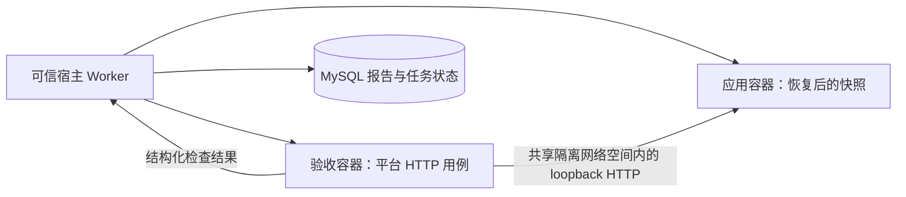

# 第六阶段：让独立验收决定成果是否交付

这一阶段把“模型提交代码”接到“平台验证并交付”。读完后，你应当能解释为什么开发测试不能代替正式验收、为什么裁判必须与应用分开运行，以及失败如何驱动有上限的修复。

完整链路是：提交不可变快照 → 调度验收 → 独立 HTTP 检查 → 失败反馈与最多两轮修复 → 复验 → 成功产物下载。第五阶段真实模型生成的笔记 API 已接受独立验收，来源记录和本次验收报告分别保留；本次复验没有新增模型调用。

## 1. 实现者提交答卷，平台保管评分规则

模型编写的开发测试用于帮助模型调试，但模型也可能同时误解代码和测试。finish 因此只提交快照，不能直接写 SUCCEEDED。

平台验收器运行人工编写的 HTTP 用例，检查接口返回值、错误处理、边界和进程重启后的持久化。验收入口是 [Verifier](../src/spec2repo/harness/verification.py)，具体用例是 [受保护的 HTTP 检查程序](../src/spec2repo/harness/acceptance_runner.py)。验收器不运行生成仓库中的 pytest、conftest.py 或插件，也不导入生成的 Python 模块。

可以把它理解成：开发测试是学生自己检查答案；正式验收是老师拿着另一份评分规则检查答卷。两者都需要，但职责不同。

## 2. 为什么是两个容器

把测试文件设为只读，却让测试与生成代码在同一 Python 进程里运行，仍可能受到 monkeypatch、导入遮蔽或 pytest 插件影响。因此应用与验收程序使用不同的容器、进程空间和文件系统。



应用容器使用 network=none；验收容器通过 container 网络模式加入它的网络命名空间，双方通过 127.0.0.1 通信，不发布宿主端口，也不获得外网路由。共享网络空间不等于共享 PID 或文件挂载。[Docker 官方网络说明](https://docs.docker.com/engine/network/)解释了 container 网络模式的语义。

验收容器没有生成工作区挂载，没有宿主密钥或数据库配置，使用 Python 隔离模式运行可信检查程序。两个容器都沿用非 root、只读根文件系统、capabilities 清空、CPU/内存/PID 限制和超时清理。应用 stdout 不能作为验收结论，只有验收容器输出的报告被平台读取。

应用需要写 SQLite，所以恢复出来的应用工作目录仍可写。它修改的是验收 attempt 的副本，正式交付始终指向模型提交的原始不可变快照，不把测试运行后产生的数据库混进成果。

## 3. 套件与规格如何绑定

套件按完整 CoreSpec 指纹注册，不按标题或 spec id 猜测适用范围。报告同时记录规格 hash、快照 hash、套件 hash、镜像 ID 与执行代次。

套件 hash 包含检查程序、编排代码与镜像身份。任务修复期间如果验收程序发生变化，提交会冲突，不能在同一条结果链中偷偷降低标准。未知规格返回 ERROR，不会把“没有测试可跑”解释为通过。

本轮冻结两份同栈契约：笔记 API v1，以及任务管理 API v2。任务规格升级到 v2，是为了显式规定 app:app 启动入口，避免验收器偷偷假定用户没有要求的目录结构。它不规定业务骨架，模型工作区仍从空目录开始。

每份套件包含一个基础输入组和两个冻结变体。笔记检查创建、非法长度、读取、缺失资源和重启持久化；任务检查修剪标题、分页、非法参数、状态转换与重启持久化。输入变体不会加入修复上下文。有限样例提供行为证据，不是对所有可能输入的形式化证明。

## 4. 验收失败怎样变成修复任务

实现提交先进入 WAITING_VERIFICATION，释放执行权。recovery 进程扫描等待状态，在事务里推进到 QUEUED 并写 Outbox；验收仍由同一套租约 Worker 领取。

```text
IMPLEMENT 提交 → WAITING_VERIFICATION → QUEUED → VERIFY
    验收通过：SUCCEEDED
    业务失败，尚有修复次数：QUEUED → REPAIR → 提交 → VERIFY
    业务失败，修复次数耗尽：FAILED
    未注册套件或验收基础设施异常：FAILED，报告 outcome=ERROR
```

验收报告、状态变化、attempt 结束与修复 Outbox 在同一个 MySQL 事务里提交。注入事件写入故障时，这些写入全部回滚。两个扫描器并发调度同一等待任务时，行锁与 SKIP LOCKED 防止重复推进。

修复使用新代次工作目录，从失败版本的已提交快照恢复。模型收到验收项 ID、需求 ID、期望行为与受控实际结果，继续使用原来的文件与终端工具。反馈不含完整验收源码、冻结样例或应用任意响应正文。

## 5. 修复上限和模型预算是两道约束

最多两轮修复意味着首次验收加最多两次修复后复验。次数依据持久报告中实际安排过的修复累计，不因进程重启、换 Worker 或规格澄清重置。

模型调用、token 预留和时间预留继续使用整条 run 的累计预算。还有修复次数不代表一定还有模型额度；预算先耗尽时，运行时会结束任务。验收本身没有模型调用，因此不会消耗模型轮次，但有独立的容器执行与 HTTP 超时。

真实进程丢失属于故障接管，和业务验收失败不同。过期 Worker 无权提交报告；验收进程中断可以从同一提交快照重新验证，已经提交的报告不会被旧代次覆盖。容器管理错误与未知套件单列 ERROR，不反馈成“请模型修复业务代码”。

## 6. 为什么重启测试不能用同一进程里的第二次读取代替

只检查“创建后能读”，内存字典也能通过。验收器先创建资源，把资源身份保存在自己的控制流程中，再重启应用容器，最后重新读取并比较结果。

重启保留的是同一数据库文件，丢失的是应用进程内存。测试专门准备了内存 SQLite 实现，它可以通过进程内读写，但被重启检查拒绝。另一个用例让应用启动即异常，也不会被判定通过。

## 7. 产物下载与报告查询

owner 可以查询本任务的历次报告。成功任务才能获得正式产物清单和仓库 ZIP；下载前验证快照 hash。越权请求返回 404，不泄露他人任务和文件；文件丢失或校验失败返回 503。

产物关联的 verification sequence、规格 hash 和套件 hash 使“这份代码为什么被交付”有据可查。成功状态必须由受租约保护的验收提交产生，空检查报告或覆盖不完整的报告不能进入 SUCCEEDED。

## 8. 实验证据及口径

本轮使用笔记与任务两个已有规格，先把同栈验收与恢复边界做实；预约管理案例留到联调扩展，不把两个案例包装成跨语言或跨领域泛化。

- **真实生成成果**：第五阶段 deepseek-flash 的笔记快照接受独立 HTTP 验收，15 项检查通过，下载校验通过。验收导入 run 显式关联原生成 run，保留原调用预算；它不是另一次模型样本。
- **正式修复闭环**：脚本模型先提交允许空字符串的错误版本，验收失败；收到 A2 反馈后修复，再验收通过。真实容器承载生成代码和验收，脚本模型只控制测试动作。
- **第二业务套件**：手写任务 API 测试夹具通过 24 项检查，用于验证验收器及需求映射，不计入真实模型生成成功率，也不预填到模型工作区。
- **防伪和失败**：生成目录里的恶意 conftest.py 没有被验收器加载；内存数据库和启动失败均被拒绝；旧代次、取消、套件变化、空成功报告及事务回滚有对应测试。

全量结果与本次报告链接见 [运行记录](RUN_VERIFICATION.md)。实验样本少，只报告逐例结果；单次验收耗时不是 SLA。隔离依赖同宿主 Docker 与持久快照目录，不声称抵御任意内核漏洞或提供跨主机恢复。

阅读顺序：AgentWorker 的 VERIFY 分支 → Verifier 的双容器执行 → VerificationRepository 的事务提交 → REPAIR 上下文 → [测试](../tests/test_verification.py)。复习 [题单 Q065～Q072](INTERVIEW_QUESTION_BANK.md)。
